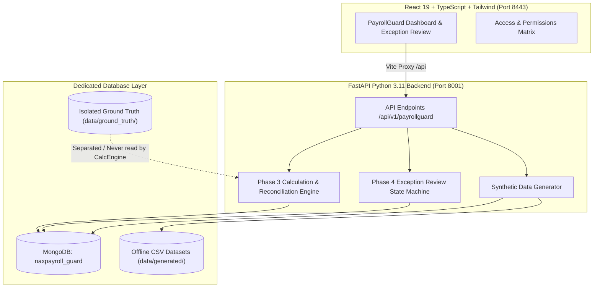

# System Architecture & Technical Reasoning

## 1. Problem Statement & Motivation

Payroll processing in enterprise human resource environments is vulnerable to subtle upstream discrepancies:
- Unapproved or duplicate timesheet entries.
- Missing statutory tax numbers or invalid bank account tokens.
- Discrepancies between approved leave and unpaid leave deductions.
- Excessive overtime without management authorization.
- Inactive or terminated employees mistakenly included in payroll calculations.

Detecting these issues *after* disbursement causes regulatory penalties, expensive clawbacks, and employee dissatisfaction. **PayrollGuard AI** was designed as an automated, pre-flight validation and reconciliation system that inspects upstream data, applies deterministic validation rules, isolates held employees, and calculates payroll with a verifiable zero-variance reconciliation invariant (`gross - deductions = net`).

---

## 2. Key Architectural Decisions & Data Isolation

### Architectural Principles:
1. **Strict Data Isolation:**
   - Dedicated database: `naxpayroll_guard` ensures PayrollGuard operations never mutate existing core HR tables.
   - Ground truth separation: `data/ground_truth/ground_truth.csv` contains test expectations and is strictly prohibited from being queried by calculation or validation services.
2. **Immutability of Runs & Audit Records:**
   - Payroll calculation runs are assigned unique run IDs (`RUN-<timestamp>-<uuid>`). Calculation results are immutable snapshots.
   - Status transitions (`OPEN -> IN_REVIEW -> RESOLVED -> REOPEN`) append new immutable records to `audit_events`.
3. **Exact Decimal Arithmetic:**
   - All financial calculations utilize Python's `Decimal` type with `ROUND_HALF_UP` and cent precision (`0.01`). Stored in MongoDB as `Decimal128` to avoid floating-point representation errors.

---

## 3. Validation Rules (VR-001 through VR-010)

PayrollGuard enforces 10 deterministic validation rules:

| Rule ID | Code | Description | Severity | Impact |
|---|---|---|---|---|
| **VR-001** | `MISSING_BANK_TOKEN` | Employee lacks a valid bank token for disbursement | `HIGH` | Payment held |
| **VR-002** | `MISSING_TAX_ID` | Employee lacks a statutory tax identifier | `HIGH` | Payment held |
| **VR-003** | `DUPLICATE_TIME_ENTRY` | Duplicate approved time entry on the same work date | `HIGH` | Deduplicated & flagged |
| **VR-004** | `EXCESSIVE_HOURS` | Approved hours exceed 200 hours within the pay period | `HIGH` | Payment held for audit |
| **VR-005** | `DUPLICATE_ALLOWANCE` | Duplicate allowance source key for the period | `MEDIUM` | Counted once & flagged |
| **VR-006** | `UNAPPROVED_TIME` | Time entry is not in `APPROVED` status | `CRITICAL` | Excluded from payment |
| **VR-007** | `DUPLICATE_DEDUCTION` | Duplicate deduction source key for the period | `MEDIUM` | Counted once & flagged |
| **VR-008** | `UNPAID_LEAVE_MISMATCH` | Approved unpaid leave without corresponding DED-005 deduction | `HIGH` | Auto-calculated deduction |
| **VR-009** | `NEGATIVE_NET_PAY` | Total deductions exceed gross pay | `CRITICAL` | Payment held |
| **VR-010** | `INACTIVE_EMPLOYEE` | Employee status is not `ACTIVE` (e.g. `TERMINATED`, `ON_LEAVE`) | `HIGH` | Payment held |

---

## 4. Reconciliation Invariant & Mathematical Model

For every pay period calculation run, the engine computes:
$$\text{Gross Total} = \sum (\text{Base Pay} + \text{Overtime Pay} + \text{Approved Allowances})$$
$$\text{Deductions Total} = \sum (\text{Statutory Deductions} + \text{Unpaid Leave Deductions})$$
$$\text{Net Total} = \text{Gross Total} - \text{Deductions Total}$$

**Reconciliation Verification:**
$$\text{Variance} = \text{Gross Total} - \text{Deductions Total} - \text{Net Total} \equiv 0.00$$

Any non-zero variance immediately triggers reconciliation failure and halts export generation. Held records (employees with blocking validation rules) are partitioned into audit logs and excluded from payable disbursements.

---

## 5. Trade-offs & Engineering Decisions

1. **MongoDB vs. Relational (PostgreSQL):**
   - *Decision:* MongoDB was chosen to support flexible semi-structured upstream payloads (arbitrary allowance/deduction breakdowns, dynamic rule metadata).
   - *Mitigation:* Strict Pydantic models in FastAPI enforce schema validation on reads and writes, while BSON `Decimal128` ensures financial precision.
2. **Deterministic Synthetic Data vs. Random Fuzzing:**
   - *Decision:* A fixed seed (`20261022`) generates deterministic employees, timesheets, and exceptions.
   - *Benefit:* Enables reproducible CI testing, deterministic ground-truth verification, and predictable demo walkthroughs without flaky test states.
3. **Graceful Degraded State vs. Hard Crash on Database Disconnect:**
   - *Decision:* The FastAPI health endpoint reports degraded status (`database: disconnected`) rather than throwing an unhandled exception when MongoDB is down.
   - *Benefit:* Reviewers can run the frontend, inspect documentation, and generate offline CSVs even before launching the local database daemon.

---

## 6. How We Know the Solution Works

1. **Automated Unit Testing (`npm test`):**
   - 8 frontend tests verifying the role and permissions cascading logic.
   - 5 backend unit tests verifying rounding behavior, salary generation determinism, and reconciliation invariance.
2. **Build & Syntax Verification:**
   - Vite production build compiles 1,908 modules with zero errors.
   - Python `compileall` passes across all backend files.
3. **Data Integrity & Ground Truth Checks:**
   - `python backend/scripts/generate_synthetic_csv.py` produces exactly 3,000 employees, 90,000 time entries, 3,000 leave records, 5,000 allowances, 5,000 deductions, 4 demo exceptions, 4 approvals, and 10 rules.
   - Checksums are verified against `data/manifests/phase2_manifest.json`.
4. **End-to-End PowerShell Verification (`Verify-PayrollGuard.ps1`):**
   - Automated end-to-end script tests backend syntax, frontend build, API health, and MongoDB connectivity in sequence.
