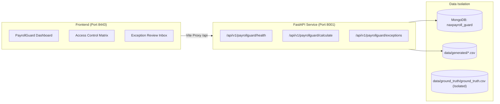

# PayrollGuard AI — Automated Pre-Flight Payroll Validation & Reconciliation

[](https://github.com/kantetipavani/PayrollGuard-AI)
[](https://react.dev/)
[](https://fastapi.tiangolo.com/)
[](https://www.mongodb.com/)
[](#5-verification--testing)

PayrollGuard AI is an intelligent pre-flight payroll auditing, calculation, and reconciliation subsystem designed to integrate with the Naxpayroll HR platform. It processes pre-payroll inputs across 3,000 employees (90,000+ time records, leave records, allowances, and deductions), enforces 10 deterministic validation rules, isolates held employees, and executes zero-variance reconciliation before salary disbursement.

---

## Quick Navigation
- [1. Make It Run (Setup & Execution Guide)](#1-make-it-run-setup--execution-guide)
- [2. Show Your Work (Repository & Architecture)](#2-show-your-work-repository--architecture)
- [3. Use LLMs Transparently (Prompt History & AI Usage)](#3-use-llms-transparently-prompt-history--ai-usage)
- [4. Make Your Reasoning Visible (Decisions & Trade-offs)](#4-make-your-reasoning-visible-decisions--trade-offs)
- [5. Verification & Testing](#5-verification--testing)
- [6. Project Structure](#6-project-structure)

---

## 1. Make It Run (Setup & Execution Guide)

Follow these clear, step-by-step instructions to install dependencies, configure the project, start services, and verify key behavior.

### System Prerequisites
- **Node.js**: v20.x or higher (`node -v`)
- **Python**: v3.11 or higher (`python --version`)
- **MongoDB**: MongoDB Community Server running locally on `127.0.0.1:27017` (Optional for offline CSV mode; required for live DB & API calculation runs)
- **Git**: Installed and configured

---

### Step 1: Clone & Configure

```bash
git clone https://github.com/kantetipavani/PayrollGuard-AI.git
cd PayrollGuard-AI
```

Create the backend environment file from the example:
- **Windows (PowerShell):**
  ```powershell
  Copy-Item backend\.env.example backend\.env
  ```
- **macOS / Linux:**
  ```bash
  cp backend/.env.example backend/.env
  ```

---

### Step 2: Install Dependencies

#### Frontend (Node.js)
```bash
npm install
```

#### Backend (Python Virtual Environment)
- **Windows (PowerShell):**
  ```powershell
  py -3.11 -m venv backend\.venv
  backend\.venv\Scripts\Activate.ps1
  python -m pip install --upgrade pip
  pip install -r backend\requirements.txt
  ```
- **macOS / Linux:**
  ```bash
  python3 -m venv backend/.venv
  source backend/.venv/bin/activate
  pip install --upgrade pip
  pip install -r backend/requirements.txt
  ```

---

### Step 3: Populate Database / Offline Synthetic Data

You can run data generation in one of two modes:

#### Option A: Offline CSV Generation (No MongoDB required)
Generates the complete 3,000 employee dataset with 90,000 time records to `data/generated/`:
```bash
python backend/scripts/generate_synthetic_csv.py --seed 20261022
```

#### Option B: Populate MongoDB Database (`naxpayroll_guard`)
Ensure MongoDB is running locally (`127.0.0.1:27017`), then run:
- **Windows (PowerShell):**
  ```powershell
  $env:PYTHONPATH = "backend"
  python backend\scripts\init_db.py
  python backend\scripts\generate_synthetic_data.py --reset --seed 20261022
  ```
- **macOS / Linux:**
  ```bash
  export PYTHONPATH="backend"
  python backend/scripts/init_db.py
  python backend/scripts/generate_synthetic_data.py --reset --seed 20261022
  ```

---

### Step 4: Run the Application

#### One-Click Launch (Windows PowerShell)
```powershell
.\start-all.ps1
```
*Alternatively, run the backend and frontend in separate terminals:*

#### Terminal 1 — Backend (FastAPI on Port 8001):
```powershell
# Windows PowerShell
$env:PYTHONPATH = "backend"
uvicorn app.main:app --app-dir backend --host 127.0.0.1 --port 8001 --reload
```
```bash
# macOS / Linux
export PYTHONPATH="backend"
uvicorn app.main:app --app-dir backend --host 127.0.0.1 --port 8001 --reload
```

#### Terminal 2 — Frontend (Vite on Port 8443):
```bash
npm run dev
```

#### Access Points:
- **Frontend Application:** [http://localhost:8443](http://localhost:8443)
- **Interactive API Documentation:** [http://localhost:8001/docs](http://localhost:8001/docs)
- **Backend Health Check:** [http://localhost:8001/api/v1/payrollguard/health](http://localhost:8001/api/v1/payrollguard/health)
- **PayrollGuard Dashboard API:** [http://localhost:8001/api/v1/payrollguard/dashboard](http://localhost:8001/api/v1/payrollguard/dashboard)

---

## 2. Show Your Work (Repository & Architecture)

- **Public Repository:** [https://github.com/kantetipavani/PayrollGuard-AI](https://github.com/kantetipavani/PayrollGuard-AI)
- **Primary Branch:** `main`
- **Commit History:** Structured commits capturing each stage from foundation to calculation, validation, and documentation.

### High-Level Architecture



For comprehensive architectural design, see [`ARCHITECTURE_AND_REASONING.md`](./ARCHITECTURE_AND_REASONING.md).

---

## 3. Use LLMs Transparently (Prompt History & AI Usage)

In compliance with transparency guidelines, full prompt histories, tool acceleration points, and human validation records are documented in [`PROMPT_HISTORY.md`](./PROMPT_HISTORY.md).

### Summary of AI Collaboration
| Area | AI Contribution | Human Oversight & Review |
|---|---|---|
| **Frontend UI** | Rapid generation of React 19 components, Tailwind CSS styling, responsive layout | Reviewed permission inheritance rules, verified modal lifecycles, inspected error boundary rendering |
| **Backend API** | FastAPI routing, Pydantic request/response schemas, OpenAPI docstrings | Configured connection timeouts, error handling on database disconnection, and CORS headers |
| **Calculations** | Scaffolded salary formulas and allowance/deduction aggregators | Enforced Python `Decimal` with cent precision (`ROUND_HALF_UP`) and BSON `Decimal128` to prevent IEEE 754 floating-point inaccuracies |
| **Data Generator** | Synthetic employee generation loops and CSV serialization | Discovered and fixed PyMongo BSON date serialization issue (converting Python `date` to UTC-midnight `datetime`) |
| **Audit Trails** | Basic status update endpoint | Mandated append-only immutable `audit_events` on all status transitions (`OPEN -> IN_REVIEW -> RESOLVED -> REOPEN`) |

---

## 4. Make Your Reasoning Visible (Decisions & Trade-offs)

### Core Validation Rules (VR-001 to VR-010)
PayrollGuard inspects upstream timesheets and employee data before calculating pay:
1. `VR-001` (**Missing Bank Token**): Holds employee from payment to avoid disbursement rejection.
2. `VR-002` (**Missing Tax ID**): Holds employee for statutory tax compliance.
3. `VR-003` (**Duplicate Time Entry**): Deduplicates same-day entries to prevent double-counting.
4. `VR-004` (**Excessive Hours**): Holds rows exceeding 200 hours in a single pay period for audit.
5. `VR-005` (**Duplicate Allowance**): Deduplicates allowance source transactions.
6. `VR-006` (**Unapproved Time**): Excludes non-approved timesheets from payable hours.
7. `VR-007` (**Duplicate Deduction**): Deduplicates deduction transactions.
8. `VR-008` (**Unpaid Leave Mismatch**): Accurately computes pro-rated unpaid leave deductions.
9. `VR-009` (**Negative Net Pay**): Holds records where deductions exceed gross salary.
10. `VR-010` (**Inactive Employee**): Blocks pay calculation for non-ACTIVE employee statuses.

### Mathematical Reconciliation Invariant
For every run:
$$\text{Gross Total} - \text{Deductions Total} - \text{Net Total} = 0.00$$
Zero variance is required for pay period reconciliation. Held employees are partitioned into audit logs and excluded from payable disbursement totals.

---

## 5. Verification & Testing

### 1. Run Automated Test Suite (Frontend & Backend)
Run the unified test runner:
```bash
npm test
```
This automatically runs:
- **Frontend Access Matrix Tests (`tests/access-permissions.test.mjs`)**: 8 tests verifying role permissions, cascading toggles, and local storage persistence.
- **Backend Calculation Invariant Tests (`tests/test_payroll_calculation.py`)**: 5 unit tests verifying rounding behavior, salary generation determinism, and reconciliation invariants.

### 2. Verify Production Build
```bash
npm run build
```
Ensures 1,900+ modules bundle cleanly with zero syntax or type errors.

### 3. Verify Python Syntax
```bash
python -m compileall backend
```

### 4. End-to-End PowerShell Automated Verification (Windows)
```powershell
Set-ExecutionPolicy -Scope Process -ExecutionPolicy Bypass
.\scripts\Verify-PayrollGuard.ps1
```

---

## 6. Project Structure

```
PayrollGuard AI/
├── backend/
│   ├── app/
│   │   ├── api/
│   │   │   ├── payrollguard.py         # Dashboard, health, rules, exceptions API
│   │   │   ├── payroll_calculation.py  # Phase 3 calculation & reconciliation engine
│   │   │   └── naxpayroll.py           # Core Naxpayroll mock integration
│   │   ├── core/config.py              # Environment configuration & settings
│   │   ├── db/schema.py                # Collection definitions & rule registries
│   │   └── main.py                     # FastAPI entrypoint & middleware
│   ├── scripts/
│   │   ├── generate_synthetic_csv.py   # Offline standalone CSV generator
│   │   ├── generate_synthetic_data.py  # MongoDB database generator
│   │   └── init_db.py                  # Database index and collection setup
│   ├── requirements.txt                # Python backend dependencies
│   └── .env.example                    # Example backend configuration
├── src/
│   ├── App.tsx                         # Main app shell & navigation router
│   ├── PayrollGuardView.tsx            # PayrollGuard AI UI (Dashboard & Exceptions)
│   ├── AccessRoles.tsx                 # Role-based access control matrix
│   ├── AccessUsers.tsx                 # User assignment & permissions UI
│   ├── access-permissions.ts           # Permission hierarchy & cascading rules
│   └── api/client.ts                   # Typed API client for PayrollGuard backend
├── data/
│   ├── generated/                      # Pre-generated 3,000 employee CSV dataset
│   ├── ground_truth/                   # Isolated test ground-truth (never read by calc)
│   └── manifests/                      # SHA-256 validation manifests & counts
├── docs/                               # Detailed phase-by-phase design specifications
├── tests/
│   ├── access-permissions.test.mjs     # Node.js permission test suite
│   └── test_payroll_calculation.py     # Python calculation & reconciliation tests
├── scripts/
│   ├── Start-PayrollGuard.ps1          # Automated full-stack starter script
│   └── Verify-PayrollGuard.ps1         # Automated verification script
├── ARCHITECTURE_AND_REASONING.md       # Technical deep-dive & decision log
├── PROMPT_HISTORY.md                   # AI transparency & prompt evolution
├── start-all.ps1                       # Quick launch script (backend + frontend)
├── package.json                        # Frontend packages & test scripts
└── README.md                           # Main documentation & setup guide
```
